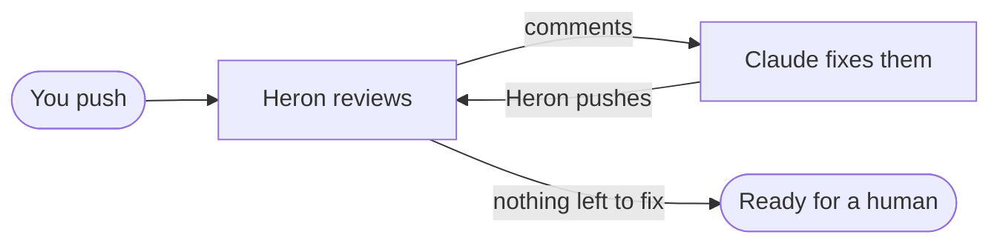

# Heron

Run automatic code reviews on your GitHub pull requests using your Claude Code subscription. A highly configurable app for macOS and Windows, now with [iterations](#iterations-review-fix-repeat): Heron reviews, Claude fixes, repeat.

<!-- TODO: demo video. Drag the .mp4 into this file on github.com to get an embed link, then paste it here. -->


https://github.com/user-attachments/assets/6c38713a-68e7-4abe-ae0a-b169fc9feacf


## How it works

1. Heron checks your chosen repos on GitHub every 10 seconds.
2. When a pull request is opened or pushed to, Heron checks it out on your computer and runs Claude Code on it.
3. Claude's review is posted to the pull request as comments from your GitHub account.

A burst of pushes gets one review: Heron waits 5 seconds after each push before starting. Pushing again during a review cancels it and reviews the new commit.

## Get started

### 1. Install the tools Heron uses

- `git`
- `gh`, logged in: `gh auth login`
- `claude`, logged in: run `claude`, then `/login`

On launch, Heron checks all three and shows how to fix anything missing. Reviews don't start until they all pass.

On Windows:

- `git`: `winget install Git.Git`. Git for Windows also brings Git Bash, which runs the [setup command](#settings) (PowerShell without it).
- `gh`: `winget install GitHub.cli`, then `gh auth login`.
- `claude`: the native installer, in PowerShell: `irm https://claude.ai/install.ps1 | iex`, then run `claude` to log in. Heron runs `claude.exe` itself, never npm's `claude.cmd` wrapper.
- Optional: turn on long paths (`LongPathsEnabled`, needs admin) if a setup command's `node_modules` gets deep. The Doctor shows the command.

### 2. Build and open the app

**macOS** (Apple silicon). Needs Node 22+ and pnpm 11.

```bash
pnpm install
pnpm dist           # → apps/desktop/dist/Heron-<version>-arm64.dmg
```

The build is unsigned, so the first time you open it, right-click the app → Open.

**Windows** 10 22H2 or 11, x64 (ARM PCs run it under emulation). The installer is built on Windows by GitHub Actions: run the **Windows** workflow (Actions → Windows → Run workflow), or push a `v*` tag, and download `heron-windows-installer` from the run's artifacts. On a Windows machine you can also build it yourself with `pnpm install` and `pnpm dist:win`.

It installs for your user only, with no admin prompt. It's unsigned, so SmartScreen warns the first time: More info → Run anyway.

### 3. Add a repository

Settings (⚙ at the bottom of the sidebar) → **Repos** → add one, then choose what to review:

- **All PRs**: every pull request in the repo.
- **Only mine**: pull requests you opened.
- **Manual**: only the pull requests you pick.

Drafts are skipped unless you turn them on.

Pull requests that were already open when you added the repo aren't reviewed automatically. Open one and click **Review now**.

### 4. Pick how it reviews (optional)

The **Default** profile is ready to use: the bundled `pr-review` skill on Opus at high effort. To change it, go to Settings → **Profiles**. A profile is either a prompt or a skill, plus the model, effort, timeout and max turns. Each repo can use its own profile.

### 5. Try a dry run (optional)

Settings → **General** → **Dry run** runs reviews but keeps them in the app instead of posting to GitHub. Useful while you tune a profile.

## The review skill

Heron comes with a `pr-review` skill, and the Default profile uses it. **We highly recommend it.** It looks for bugs, questionable decisions and code smells, and leaves one short comment on the lines each problem concerns. You can read and edit it in Settings → **Skills**.

If you write your own skill or prompt, prioritize finding concrete bugs and keep each correction short and to the point. Big reviews tend to be ignored or taken less seriously.

Heron gives every review the PR details, the diff and earlier comments (in a `.heron/` folder in the checkout), and tells Claude how to format the output. `gh` isn't available during a review, so skills shouldn't rely on it.

## Iterations: review, fix, repeat

**Heron can fix your pull requests, not just review them.** Turn on reviews and iterations for the same repo and they feed each other: Heron reviews your push, Claude fixes what the review found, Heron pushes the fix, and that push gets reviewed again.



Each lap checks the last fix, so the PR gets cleaner until the review has nothing left to ask for. Comments from teammates and bots join the same loop. After 6 Heron pushes in a row with no push from anyone else (the loop cap), the PR stops and waits for you to click **Iterate**.

### Turning it on

Iterations are **off** for every repo. Turn them on in Settings → **Repos** → **Iteration**. With the defaults, Heron only sorts the comments: you click **Iterate** to start Claude and **Push** to send its commit, after reading the diff in the app. Set **Automatic iteration** to **Automatic** and turn on **Push automatically** to let the loop run with no clicks.

### One lap

1. 30 seconds after the newest comment, a quick Haiku call sets aside the ones that don't ask for a change (questions, praise, things already done).
2. Claude gets the rest in one prompt on a fresh checkout of the PR, fixes the valid ones and notes why it left any alone.
3. Heron commits as you, with a [Conventional Commits](https://www.conventionalcommits.org) title. Once pushed, it replies on each thread with `Addressed in abc1234 — <note>` and resolves it, or `Not addressed — <reason>` and leaves it open. A reply on a handled thread sends it through again.

### Settings

Per repo, in Settings → **Repos** → **Iteration**:

- **Comments to iterate on**: **All comments**, or **My comments** (yours, which includes Heron's reviews).
- **Profile**: model, effort, timeout and max turns. Default is Opus at high effort.
- **Replies**: on by default. Turn off to keep Claude's notes in the app.
- **Setup command**: e.g. `pnpm install`, so Claude can run tests and type checks.
- **Local checkout**: work in your own clone instead of Heron's copy. It must be on the PR's branch, at its latest commit, with no uncommitted changes.

Settings → **General** has parallel iterations (2), the wait after the last comment (30 seconds) and the loop cap (6).

### Good to know about iterations

- Only pull requests you opened from a branch in the same repo. Forks and other people's PRs are never changed.
- Heron never force-pushes. If the branch moves mid-run, the result is dropped and the comments run again on the new commit.
- No dry run: to post nothing, leave **Push automatically** and **Replies** off.
- With **All comments**, anyone who can comment on your PR can steer Claude, which runs with full tools on your computer. Check the diff before you push, or use **My comments**.

## Good to know

- Reviews are posted as you, as a plain comment review (never approve or request changes).
- Claude runs with full tools on the pull request's code on your computer. Be careful with **All PRs** on repos where people you don't know can open pull requests.
- Closing the window keeps Heron running in the menu bar (the system tray on Windows). Quitting stops all reviews; they resume on the next launch.
- Data lives in `~/Library/Application Support/Heron` (`%LOCALAPPDATA%\Heron` on Windows).

## Develop

```bash
pnpm install
pnpm dev            # electron-vite dev server with HMR
pnpm typecheck      # all packages (turbo)
pnpm lint
```

Set `HERON_DATA_DIR=/some/dir` to run against a separate copy of the data.
